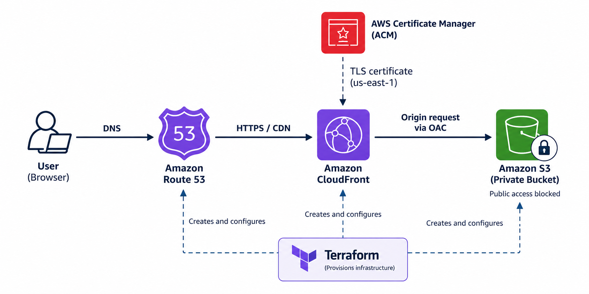

# Secure Static Website Hosting on AWS with Terraform

This project defines AWS infrastructure for secure static website
delivery using Terraform. Website files are stored in a private Amazon
S3 bucket and delivered through Amazon CloudFront. Amazon Route 53
handles DNS, AWS Certificate Manager (ACM) provides the TLS certificate,
and CloudFront Origin Access Control (OAC) restricts access to the S3
origin.


## Architecture



**Request flow:** User → Route 53 → CloudFront → Private S3 bucket\
**Security:** ACM certificate enables HTTPS on CloudFront; OAC allows
CloudFront to access the private S3 origin.\
**Infrastructure:** Terraform provisions and configures the AWS
resources.

## AWS Services

-   **Amazon S3** --- Stores static website files in a private bucket.
-   **Amazon CloudFront** --- Distributes content and serves HTTPS
    requests.
-   **Origin Access Control (OAC)** --- Allows CloudFront to access the
    S3 origin without making the bucket public.
-   **AWS Certificate Manager (ACM)** --- Supplies the TLS certificate
    used by CloudFront. CloudFront certificates must be in `us-east-1`.
-   **Amazon Route 53** --- Maps a configured custom domain to the
    CloudFront distribution.
-   **Terraform** --- Defines and manages infrastructure as code.

## Prerequisites

-   AWS account with permissions to manage the services above.
-   Terraform installed.
-   AWS credentials configured securely.
-   A domain and Route 53 hosted zone if using a custom domain.
-   Static website files, such as `index.html`, CSS, JavaScript, and
    images.

## Configure and Deploy

Review the Terraform files in this repository first. Use the variable
names and file structure actually defined in the project.

``` bash
git clone https://github.com/VishalKonde01/terraform-secure-static-website-hosting.git
cd terraform-secure-static-website-hosting
terraform init
terraform fmt -recursive
terraform validate
terraform plan
terraform apply
```

Review the plan before applying it. If the configuration requires input
variables, provide the values through the project's documented variable
mechanism.

## Important Configuration Notes

-   Keep S3 Block Public Access enabled.
-   Do not enable S3 static website hosting for the private-bucket +
    CloudFront OAC design.
-   Ensure the S3 bucket policy permits reads only from the intended
    CloudFront distribution.
-   Set CloudFront's default root object to `index.html` when
    appropriate.
-   Configure the ACM certificate and CloudFront alternate domain names
    consistently.
-   Create Route 53 alias records only when a domain and hosted zone are
    configured.
-   Never commit AWS credentials, secret values, Terraform state files,
    or sensitive `.tfvars` files.

## Verify

After applying the configuration, check that:

-   Terraform completed successfully.
-   The CloudFront distribution is deployed.
-   The certificate is issued and attached when custom HTTPS is
    configured.
-   Route 53 records point to the intended distribution when DNS is
    configured.
-   The S3 bucket is private and its policy allows the intended
    CloudFront distribution.
-   The configured CloudFront URL or custom domain serves the expected
    files.

## Cleanup

Review the resources that Terraform plans to remove, then destroy only
this project's resources when they are no longer needed:

``` bash
terraform plan -destroy
terraform destroy
```

Back up any required files and state before cleanup. AWS resources may
incur charges while they exist.

## 👨‍💻 Author

**Vishal Konde**

🔗 LinkedIn:

[https://www.linkedin.com/in/vishal-konde-dev](https://www.linkedin.com/in/vishal-konde-dev)

---

⭐ If you found this project useful, consider giving the repository a star!